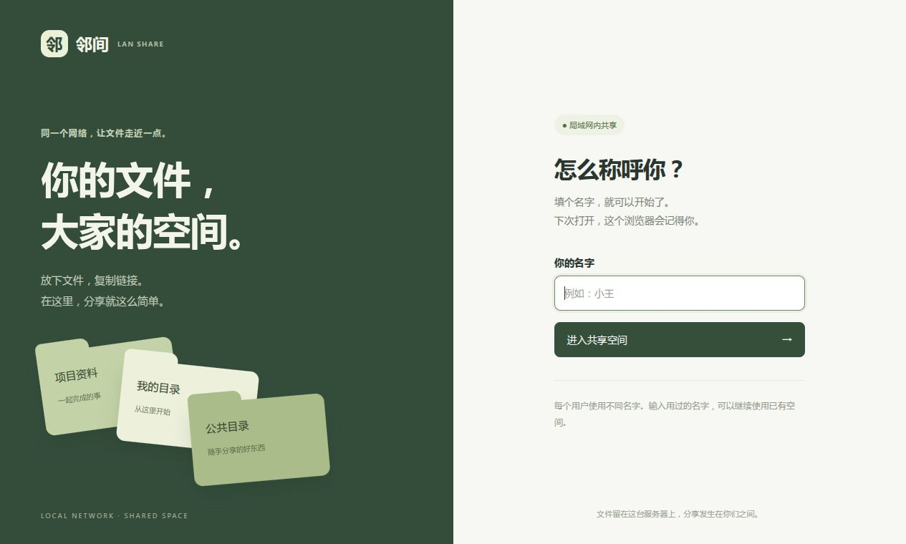
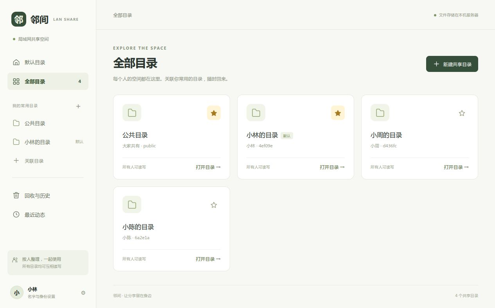
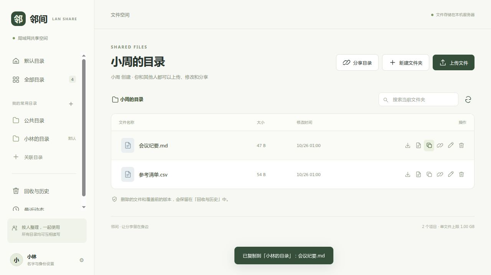
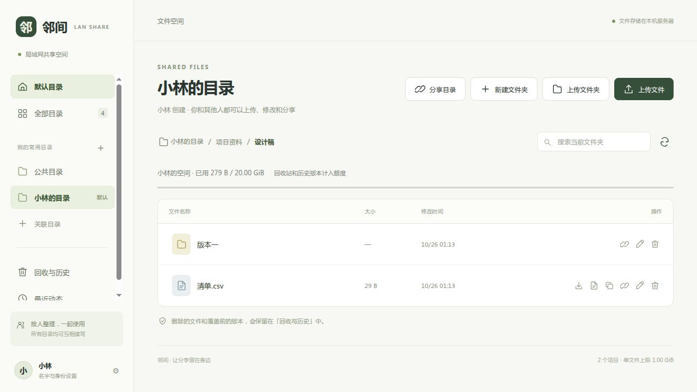
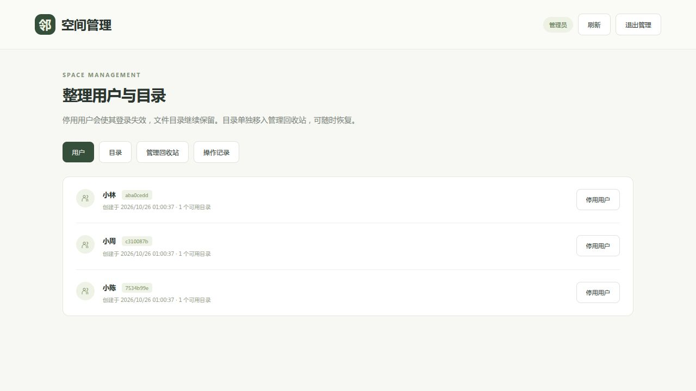
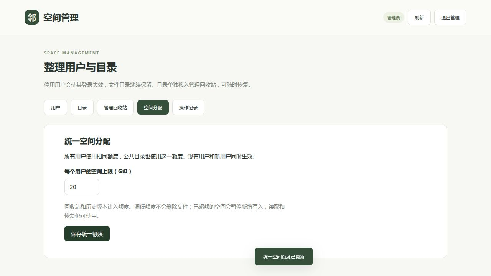
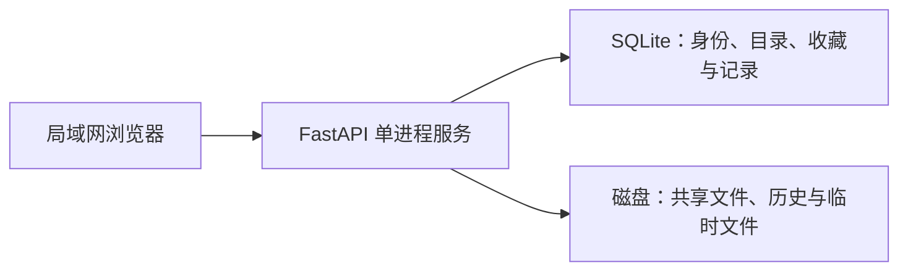

# 邻间 · LAN Share

**同一个网络，让文件走近一点。**

邻间是一个面向可信局域网的轻量文件共享站。首次填名字就能使用，每个人有自己的目录入口，也能浏览、修改其他人的文件。文件集中存放在服务器，通过浏览器上传、下载或复制，无需安装客户端。

适合家庭、工作室和小团队临时交换资料。普通用户免密，管理员单独使用密码验证；**个人目录用于整理文件，不提供私有访问权限**。

## 功能一览

| 功能 | 使用方式 |
| --- | --- |
| 名字即入口 | 新名字创建空间；已有名字继续使用原空间，禁止重名新建 |
| 目录与收藏 | 浏览所有目录，收藏常用目录，设置默认入口 |
| 文件操作 | 拖放或选择上传、下载、新建文件夹、重命名、当前文件夹搜索 |
| 文件夹上传 | 选择或直接拖入文件夹，保留目录层级、隐藏项，拖放支持空目录 |
| 存储额度 | 默认每位用户 20 GiB，管理员统一调整；公共目录使用相同额度 |
| 快速拷贝 | 将其他目录的单个文件复制到自己的目录，同名自动生成副本 |
| 链接分享 | 分享目录、子文件夹或文件链接，接收者仍需进入共享空间 |
| 文本编辑 | 在线编辑不超过 2 MiB 的 UTF-8 文本，保存前检查版本冲突 |
| 回收与历史 | 删除的内容和覆盖前的版本可恢复，恢复同名文件时需选择新路径 |
| 管理员整理 | 停用误建用户、单独回收目录、恢复用户与目录、查看管理记录 |

## 界面预览

以下为实际运行界面，使用独立演示环境与虚拟用户。

### 填名字，进入空间

同一浏览器会记住身份。换电脑后填写原名字，选择继续使用已有空间即可。



### 按人整理，常用目录随手可达

点击目录卡片进入；金色实心星表示已收藏，默认目录始终收藏。



### 从别人的目录快速复制

在文件行点击两个重叠方框的“复制到我的目录”按钮。服务器直接完成拷贝，不需要先下载再上传，原文件保留。



### 上传整个文件夹，保留目录层级

点击“上传文件夹”或直接将目录拖入文件列表，上传后保留相对路径。普通页面不展示空间额度，用满时才提示空间已满。



### 单独管理用户和目录

普通页面不展示管理入口；输入 `admin` 后才出现密码验证。停用用户保留文件，目录需要单独移入管理回收站。



### 管理员统一分配空间

“空间分配”只设置一个额度，对所有用户以及公共目录同时生效；没有单独用户设置。



## 设计思路

### 1. 降低进入成本，明确身份边界

第一次填写名字时，服务器创建用户 ID、个人目录及随机会话凭证；浏览器通过 HttpOnly Cookie 保存凭证，服务器保存凭证的哈希。同一浏览器后续自动进入，普通用户会话有效期一年。

名字全局识别启用中的用户，校验会忽略首尾空格、英文大小写及全角字符差异。服务端校验与数据库唯一索引共同防止并发重名。已停用名字保留，不能重新创建；历史重复记录不能恢复为第二个启用中的同名用户。

这是为熟人共享设计的身份记忆方式。**知道名字的人可以继续使用该身份，名字不是身份证明，操作记录也不证明实际操作者是谁。** 浏览器无法自动认出同一台电脑的所有浏览器；切换主机名或 IP 时，Cookie 也不共享。

### 2. 目录独立，访问共享

文件按用户或主题分目录存放，所有普通成员都能互相读写。目录属于服务器存储，不直接映射每个人电脑上的文件夹。收藏和默认目录只是个人入口设置，取消收藏不会删除文件。

“复制到我的目录”优先选择自己拥有的默认目录；如果默认入口指向别人或公共目录，则选择自己最早创建的可用目录。副本存入目标根目录，同名自动加“副本”编号。如果没有可用的自有目录，会提示先创建目录。

### 3. 允许协作，也留下撤回余地

上传先写临时文件，完成后检查目标版本并原子替换；多人修改同一文件时，旧版本提交会被拒绝。删除和覆盖前的内容进入回收与历史，管理员回收目录也保留原文件。

文件变更使用单进程锁协调，数据库操作失败时回滚相应文件变更。这能处理常见并发和操作错误，但不等于数据库与文件系统之间的断电事务，也不能代替备份。

### 4. 轻量部署，数据留在本地



前端使用原生 HTML、CSS、JavaScript，无构建步骤、CDN 或外部字体；后端使用 FastAPI 和 SQLite，不需要额外数据库服务。Docker 命名卷保存数据，重建容器不会丢失用户与文件。Nginx 可作为可选的固定域名入口。

## 快速开始

需要 Docker Engine 和 Docker Compose。`manage.sh` 同时支持 `docker compose` 与旧版 `docker-compose`。

克隆仓库后启动：

```sh
git clone https://github.com/zhufeng-ls/lan-share.git
cd lan-share
cp .env.example .env
./manage.sh up -d --build
./manage.sh ps
```

打开 [http://127.0.0.1:8787](http://127.0.0.1:8787)。默认只监听本机，适合先体验或放在主机反向代理后面。

要让局域网其他设备直接访问，修改 `.env` 的 `BIND_IP` 为这台服务器的**局域网网卡 IP**，例如 `192.168.1.10`，重建容器后使用 `http://192.168.1.10:8787`。服务器防火墙需允许可信局域网访问该端口。

```sh
./manage.sh stop
./manage.sh rm -f
./manage.sh up -d
```

主机需要保持开机。容器配置了 `restart: unless-stopped`；Docker 随系统启动后，未手动停止的服务会自动恢复。

### 配置项

| 变量 | 默认值 | 说明 |
| --- | --- | --- |
| `BIND_IP` | `127.0.0.1` | Docker 发布端口绑定的主机地址 |
| `PORT` | `8787` | 主机访问端口 |
| `MAX_UPLOAD_MB` | `1024` | 单文件上传上限，按 MiB 计算 |
| `PUBLIC_URL` | 空 | 固定的分享链接前缀；空值使用当前访问地址 |
| `COOKIE_SECURE` | `false` | HTTPS 部署才能启用；HTTP 启用后会无法记住身份 |

固定域名可以只解析到内网 IP，不需要开放公网入口。推荐所有设备使用同一地址，避免各 IP、域名之间重复填写名字。80 端口代理示例与维护命令见 [部署与维护](docs/deployment.md)。

### 设置管理员密码

服务启动后，在服务器交互终端执行：

```sh
./set-admin-password.sh
```

输入两次 10–256 位密码，输入内容不回显。没有初始密码，未设置时不能登录管理员。进入网页，在名字框输入 `admin` 后验证密码；已有普通身份可通过左下角“名字与身份设置”切换。

管理员密码单独使用 scrypt 哈希保存，会话有效期 8 小时；连续 5 次密码错误暂停一分钟。再次运行脚本可重置密码，并撤销旧管理员会话。

## 文件夹上传与统一空间额度

- 文件夹可通过“上传文件夹”按钮选择，也可从系统文件管理器直接拖入文件列表；支持同时拖入多个文件和目录，保留最外层目录名及内部结构。浏览器目录选择依赖 [`webkitdirectory`](https://developer.mozilla.org/en-US/docs/Web/API/HTMLInputElement/webkitdirectory) 与相对路径。
- 单文件仍受默认 1 GiB 限制。上传前检查总大小，写入时服务端再次检查，防止并发请求超额。
- 同名目录合并层级，同名文件逐个询问是否覆盖；覆盖前的内容继续保留在历史中。
- 按文件依次提交，取消或失败时已完成的文件保留，未完成文件的临时数据会清理；已经建立的目录保留；这不是整个文件夹的原子提交，也不支持断点续传。
- 拖放会递归读取目录（包括空目录和点号隐藏项），重复读取直到所有批次结束，一次最多 10000 个文件和目录。读取失败或取消会明确提示，不静默跳过。目录选择器如只提供文件列表，空目录仍需通过拖放或网页新建。
- 每位用户所有目录默认合计上限 **20 GiB（21,474,836,480 字节）**，包括普通文件、回收站、覆盖历史和管理员回收的目录。别人写入你的目录也计入你的额度。公共目录使用相同的统一额度，由所有人共用。管理员可以在“空间分配”中统一调整为 1–10240 GiB 的整数值；设置立即生效且重启保留。
- 文件站不按点号过滤名称，`.env`、`.config` 等上传后正常显示。若本机文件选择窗口没显示隐藏项，启用系统的“显示隐藏文件”，或直接拖入其上级目录。浏览器未授权或无法读取的内容不能由网页补读。
- 普通页面不展示总额度、已用量或剩余空间。写入超额时只提示“空间已满，请联系管理员调整空间。”；调低额度不删除已有内容，超额用户仍可读取和恢复。
- 上传和快速拷贝都会预留容量；额度按文件内容字节计算，不包含数据库和文件系统元数据。已有超额资料不会被删除，但新增内容会被拒绝。
- 普通删除和管理员回收不释放额度，恢复文件也不会重复计费。目前没有永久清理按钮；历史较多时需由服务器维护者先备份，再安排离线清理，不能通过停用身份或新建目录重置额度。

## 使用范围与限制

- 仅适合互相信任的局域网成员。隐藏管理员入口只是界面设计，权限由后端独立验证。
- 普通用户拥有共享读写能力，没有私密目录、逐文件权限或企业身份认证。
- 默认 HTTP 不加密传输；不要将这种免密共享方式直接暴露到公网。HTTPS 需要反向代理与应用来源校验一起配置。
- 回收和历史默认不自动清空，计入每人 20 GiB 额度；额度可由管理员统一调整；整台服务器仍需监控磁盘余量。
- 当前不支持整目录复制、目录整包下载、断点续传、Office 实时协作。
- 仅支持单进程实例写入一个数据卷，部署保持 `--workers 1`。

## 开发与验证

```sh
python3 -m venv .venv
.venv/bin/pip install -r requirements-dev.txt
.venv/bin/python -m pytest -q
# 目录读取测试使用 Node.js 内置测试器，无需 npm 安装依赖
node --test tests/test_upload_tree.mjs
DATA_DIR="$PWD/data" .venv/bin/uvicorn app.main:app --host 127.0.0.1 --port 8787 --workers 1
```

当前包含 71 项接口测试与 9 项目录读取测试，覆盖身份复用、名字唯一性、路径校验、权限、上传冲突、并发复制、失败回滚、回收恢复、管理员操作、文件夹层级、跨目录容量汇总、并发超额拦截、统一额度持久化及调低额度后的写入拦截、隐藏项、空目录以及超过 100 项的分批目录读取。截图中的登录、目录、复制及管理员页面已在独立演示环境实际验证。

```text
app/
  main.py             # 身份、目录、文件操作与数据初始化
  admin_routes.py     # 管理员验证、用户停用与目录回收
  admin_security.py   # 密码哈希与校验
  admin_password.py   # 本机设置管理员密码
  static/             # 浏览器界面与目录递归读取模块
tests/               # 接口测试
docs/                # 部署说明与界面截图
compose.yaml         # 容器与持久化卷
```

## 开源协议

项目采用 [MIT License](LICENSE)，允许使用、修改、分发和商业使用，分发时需保留版权与许可声明。第三方依赖适用各自的许可证。

许可标准文本来源：[Open Source Initiative · MIT](https://opensource.org/license/mit)。
